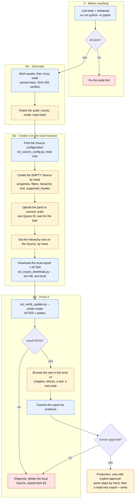

# Tests and the local rehearsal

Official content reaches OCL in two ways: most of the time an **existing Source is updated**, and
sometimes a **new Source is created**. Either way, nothing goes to production before it has run
against a local OCL instance and the result has been checked and documented. This page defines the
three test layers, the two end-to-end flows, and the evidence a reviewer should receive.

| Layer | What it proves | How it runs | Needs OCL? |
| --- | --- | --- | --- |
| **Unit** | Every tool and pipeline behaves as documented | `uv run python -m pytest` | No |
| **Rehearsal** (inside the suite) | The tools agree with each other and with the documented importer semantics: export → build → apply → verify | Same command (`tests/icd10/test_e2e_rehearsal.py`, `tests/icd11/test_create_rehearsal.py`) | No: it *simulates* the importer |
| **E2E on a local OCL** | The real server did exactly what the artifact proposed | Manual, this page | Yes: your local instance |

The rehearsal is **not** evidence about a server. Only the E2E layer is.

## Running the unit tests

```bash
uv run python -m pytest                 # everything: tools, ICD-10, ICD-11
uv run python -m pytest tests/icd10     # one terminology
uv run python -m pytest tests/icd11
```

The suite needs no network, no token, and no OCL instance. Always run it first: an E2E run on top of
a failing suite proves nothing.

## Configuration: `OCL_API_URL` and `OCL_API_TOKEN`

Every tool that talks to OCL reads the same two variables, so one place says which instance the
project points at ([`tools/ocl_env.py`](../tools/ocl_env.py)). Resolution order, first match wins:

1. a variable already exported in the shell;
2. the file given with `--env-file`, or by `$OCL_ENV_FILE`;
3. `.env` in the repository root.

Keep **one file per instance** so a production token is never next to a local URL:

```bash
cp .env.example .env.local        # OCL_API_URL=http://api.ocl.localhost   + your local token
cp .env.example .env.production   # OCL_API_URL=https://api.openconceptlab.org + your production token
chmod 600 .env.local .env.production
```

Every `.env*` file except `.env.example` is ignored by Git. Only these two variables are read; any
other key in the file is ignored. Each tool prints the target before it does anything:

```text
OCL target: http://api.ocl.localhost | token: set (settings from .env.local)
```

The token is never printed. Two instance facts the tools rely on:

- **Local HTTP** is accepted only for `localhost` and `*.localhost` (such as `api.ocl.localhost`) and
  only with `--allow-insecure-localhost`.
- **Production requires a token even to read**: without one, `…/export/`, the Source page, and
  `versions/` all answer `403 Authentication required. Anonymous API access is disabled.`
- **A local oclapi2 (observed on 2.3.208-dev) wraps errors in the negotiated format.** An export
  request sends `Accept: application/zip`, so an unauthenticated one returns `401` with the error
  JSON *inside a small ZIP*. `ocl_http.py` unwraps it and never prints a binary body. A `404` on the
  Source page without a token can mean "private" or "not created yet"; a token tells them apart.

## Rules that hold in every step

- **Production is read-only here.** Tools in this repository only `GET`. A production write needs
  your explicit, separate approval and is done by hand.
- **Uploads are manual**, locally too: upload the single-member `*.bundle.zip`, or extract `*.parts.zip` and upload each inner part ZIP in numeric order through the OCL bulk-import form with one Queue ID. Never upload the outer `.parts.zip`; no script here uploads, and the sibling `ciel-scripts` option `bulk_import_refactor.py --upload` is deliberately **not** used.
- **Never ask the server to generate an export** from a tool: `ocl_export_download.py` stops on `204`
  (no export ready) and tells you to generate it in OCL.
- An export is a snapshot. Build from a fresh one, and keep its SHA-256: the audit records it, and the
  verifier refuses an artifact that was built from a different one.

## Flow A: update an existing Source (the common case)

```mermaid
flowchart TD
    subgraph UNIT["0 · Before anything"]
        U["Unit tests + rehearsal<br/>uv run python -m pytest"]:::auto
        UOK{"all pass?"}
        FIX["Fix the code first"]:::stop
    end

    subgraph SEED["A1 · Seed a local replica of production"]
        P1["Download the production export, GET only<br/>ocl_export_download.py --env-file .env.production"]:::auto
        P2["Generate the replica seed, offline<br/>ocl_replica_seed.py: Source config + ordered parts"]:::auto
        P3["Create the local Source from source.create.json,<br/>upload the parts by hand in order, wait for the task"]:::manual
        P4["Apply post_import.patch.json (hierarchy root),<br/>add pt_BR and fr to supported_locales, by hand"]:::manual
        P5["Download the local export = BEFORE<br/>ocl_export_download.py --env-file .env.local"]:::auto
        P6["Replica fidelity: production vs BEFORE<br/>ocl_verify_update.py with an empty artifact"]:::auto
        F1{"identical?"}
    end

    subgraph BUILD["A2 · Build the update from BEFORE"]
        B1["cli.py build --export BEFORE.zip<br/>mode source-export, upload_ready true"]:::auto
        B2["Review the diff<br/>--dev-audit, alignment_report.csv"]:::manual
    end

    subgraph APPLY["A3 · Apply on the local instance"]
        L1["Choose bundle ZIP or extract parts ZIP,<br/>upload one-member files in order, one Queue ID"]:::manual
        L2["Wait for the import task to finish"]:::manual
        L3["Download the local export = AFTER<br/>ocl_export_download.py --env-file .env.local"]:::auto
    end

    subgraph PROVE["A4 · Prove it"]
        V1["ocl_verify_update.py --mode update<br/>BEFORE x AFTER x artifact x audit"]:::auto
        V2{"result PASS?"}
        V3["Commit the report as evidence"]:::auto
        D["Diagnose: fix the pipeline or the data,<br/>reset the replica, repeat from A2"]:::stop
    end

    subgraph PROD["A5 · Production, only with explicit approval"]
        PR0["Add pt_BR and fr to supported_locales (Source PATCH),<br/>apply the Source config + reindex, by hand"]:::manual
        PR1["Fresh production export, rebuild with --export<br/>the audit must name that snapshot"]:::auto
        PR2["Upload by hand, parts in order"]:::manual
        PR3["Read-only export AFTER + verify on production<br/>attach the report"]:::auto
    end

    R["Human review of the evidence"]:::manual
    AP{"approved?"}

    U --> UOK
    UOK -- no --> FIX
    UOK -- yes --> P1
    P1 --> P2 --> P3 --> P4 --> P5 --> P6 --> F1
    F1 -- no --> P3
    F1 -- yes --> B1
    B1 --> B2 --> L1 --> L2 --> L3 --> V1 --> V2
    V2 -- no --> D
    V2 -- yes --> V3 --> R --> AP
    AP -- no --> D
    AP -- yes --> PR0 --> PR1 --> PR2 --> PR3

    classDef auto fill:#e8f1ff,stroke:#2563eb,color:#111
    classDef manual fill:#fff4d6,stroke:#b7791f,color:#111
    classDef ref fill:#eee,stroke:#777,color:#111
    classDef stop fill:#ffe3e3,stroke:#c53030,color:#111
```



Blue steps are repository tools, yellow steps are done by a person, grey is a read-only reference in
the sibling `ciel-scripts` repository, and red stops the flow.

### Commands (ICD-10 names; replace owner and Source for another terminology)

```bash
# 0. unit tests and rehearsal
uv run python -m pytest

# A1. production snapshot (read-only) and the local replica
uv run python tools/ocl_export_download.py --env-file .env.production \
    --owner WHO --source ICD-10-WHO --out exports/prod/WHO_ICD-10-WHO_HEAD.zip

uv run python tools/ocl_replica_seed.py --export exports/prod/WHO_ICD-10-WHO_HEAD.zip \
    --out-dir exports/replica/WHO_ICD-10-WHO
#   writes source.create.json, replica_part_001..N.ndjson, post_import.patch.json, replica_manifest.json
#   -> create the Source on the local instance with source.create.json (the org must exist),
#   -> upload the parts by hand, in numeric order, with one Queue ID, and wait for the task,
#   -> then apply post_import.patch.json (hierarchy_root_url) and add pt_BR and fr to supported_locales.

# optional: the seed parts must reproduce the production concepts before anything is loaded
uv run python tools/ocl_verify_update.py --mode create --after exports/prod/WHO_ICD-10-WHO_HEAD.zip \
    --artifact exports/replica/WHO_ICD-10-WHO

uv run python tools/ocl_export_download.py --env-file .env.local --allow-insecure-localhost \
    --owner WHO --source ICD-10-WHO --out exports/local/before/WHO_ICD-10-WHO_HEAD.zip

: > exports/empty.ndjson
uv run python tools/ocl_verify_update.py \
    --before exports/prod/WHO_ICD-10-WHO_HEAD.zip --after exports/local/before/WHO_ICD-10-WHO_HEAD.zip \
    --artifact exports/empty.ndjson            # replica fidelity: nothing is targeted, so everything must match

# A2. build from the LOCAL before-export, so the audit names exactly what the verifier will compare
uv run python terminologies/icd/icd-10/pipeline/cli.py build --dev-audit \
    --export exports/local/before/WHO_ICD-10-WHO_HEAD.zip

# A3. by hand: choose ONE route:
#     full import: upload output/bulkimport_icd10-who.bundle.zip (contains exactly one NDJSON file), OR
#     multipart: extract output/bulkimport_icd10-who.parts.zip, then upload each inner bulkimport_part_NNN.zip
#     in numeric order, using one Queue ID. Never upload the outer .parts.zip.

# A4. after the task finishes
uv run python tools/ocl_export_download.py --env-file .env.local --allow-insecure-localhost \
    --owner WHO --source ICD-10-WHO --out exports/local/after/WHO_ICD-10-WHO_HEAD.zip

uv run python tools/ocl_verify_update.py \
    --before exports/local/before/WHO_ICD-10-WHO_HEAD.zip --after exports/local/after/WHO_ICD-10-WHO_HEAD.zip \
    --artifact terminologies/icd/icd-10/output/bulkimport_icd10-who.bundle.zip \
    --audit terminologies/icd/icd-10/output/bulkimport_audit.json \
    --report terminologies/icd/icd-10/evidence/local-update.report.json

# A5. production, only with explicit approval — by hand
#   -> PATCH supported_locales on WHO/ICD-10-WHO to ["en", "pt_BR", "fr"] and read it back;
#      the exact call is in terminologies/icd/icd-10/README.md ->
#      "Locales, name type, and Source setup before upload".
#   -> apply the Source config body (properties/filters/meta) and rebuild the concept index.
uv run python tools/ocl_export_download.py --env-file .env.production \
    --owner WHO --source ICD-10-WHO --out exports/prod/WHO_ICD-10-WHO_HEAD.zip
uv run python terminologies/icd/icd-10/pipeline/cli.py build \
    --export exports/prod/WHO_ICD-10-WHO_HEAD.zip
#   -> upload by hand, parts in order, one Queue ID, wait for the task
uv run python tools/ocl_export_download.py --env-file .env.production \
    --owner WHO --source ICD-10-WHO --out exports/prod/after/WHO_ICD-10-WHO_HEAD.zip
uv run python tools/ocl_verify_update.py \
    --before exports/prod/WHO_ICD-10-WHO_HEAD.zip --after exports/prod/after/WHO_ICD-10-WHO_HEAD.zip \
    --artifact terminologies/icd/icd-10/output/bulkimport_icd10-who.bundle.zip \
    --audit terminologies/icd/icd-10/output/bulkimport_audit.json \
    --report terminologies/icd/icd-10/evidence/production-update.report.json
```

If the local server returns `204` for an export, generate the export in the local OCL and run the
command again; the tool never triggers generation.

### What the replica seed does to the data

`tools/ocl_replica_seed.py` copies concepts faithfully, with three deliberate, recorded exceptions so
that the seed can be imported on **another** instance:

| Change | Why | Recorded in |
| --- | --- | --- |
| Parent URLs lose their version id (`/concepts/B00-B09/14269827/` → `/concepts/B00-B09/`) | The id is a row of the exporting server's database and does not exist elsewhere | `replica_manifest.json` → `parent_urls.unversioned` |
| Parents that become identical are collapsed to one | Two versions of the same parent are one parent | `…concepts_with_duplicate_parents_collapsed` |
| Parents are emitted before their children | The importer processes lines in order | `ordering.concepts_moved` |

It never emits a `Source` or `Organization` line. The `Source` line of a generic copy tool renames the
Source and adds `extras`, which would defeat a faithful replica; the Source is created from
`source.create.json`, whose `id` is the header's `short_code` (the header's own `id` is the *version*,
`HEAD`) and which leaves out server-owned fields, empty values, the export's `__export_time` artifact,
and the hierarchy settings (the root concept does not exist yet; they wait in `post_import.patch.json`).
The sibling `ciel-scripts/bulk_import_refactor.py` does the same kind of conversion, but it is written
for copying under a different name and it can upload; it is kept as a reference only.

### What `ocl_verify_update.py --mode update` checks

It reads files only (no token, no network) and exits `0` only if every check passes:

| Check | Meaning |
| --- | --- |
| `artifact-built-from-before-export` | The audit's recorded export SHA-256 is the BEFORE file (needs `--audit`) |
| `targets-present-before` / `-after` | Every concept the artifact targets exists in both exports |
| `existing-names-kept` | No existing name of a targeted concept was removed or changed |
| `additions-match-artifact` | The names that appeared are exactly the ones the artifact proposed |
| `additions-policy` | Each added name is in `pt_BR`/`fr`, typed `Fully Specified`, preferred, and active |
| `descriptions-unchanged`, `extras-unchanged`, `class-and-retired-unchanged` | Nothing else about a targeted concept moved |
| `untouched-concepts-identical` | Every concept the artifact did **not** target is identical before and after |
| `no-concept-created` | The update created no concept |

Server bookkeeping (`uuid`, versions, checksums, display fields) is ignored on purpose.

## Flow B: create a new Source



```bash
uv run python terminologies/icd/icd-11/pipeline/cli.py fetch-assets
uv run python terminologies/icd/icd-11/pipeline/cli.py build
uv run python tools/ocl_source_config.py --config terminologies/icd/icd-11/source.json   # the body to apply by hand

# ... create the empty Source, upload the parts, wait ...

uv run python tools/ocl_export_download.py --env-file .env.local --allow-insecure-localhost \
    --owner WHO --source ICD-11-WHO --out exports/local/after/WHO_ICD-11-WHO_HEAD.zip
uv run python tools/ocl_verify_update.py --mode create --owner WHO --source ICD-11-WHO \
    --after exports/local/after/WHO_ICD-11-WHO_HEAD.zip \
    --artifact terminologies/icd/icd-11/output/bulkimport_icd11-who.bundle.zip \
    --report terminologies/icd/icd-11/evidence/local-create.report.json
```

`--mode create` has no BEFORE: it requires every artifact concept to exist with exactly the names,
extras, and class the artifact carried, and the Source to hold **no concept the artifact did not**.

## Evidence to attach to a PR

The verifier report is deterministic (file names and SHA-256 only, no absolute paths, no timestamp)
and small, so it is **versioned** under `terminologies/<authority>/<terminology>/evidence/`. The
exports themselves are large and stay in the ignored `exports/` folder next to a
`.provenance.json` that records the origin, the SHA-256, and when each was taken.

| Evidence | Where it comes from |
| --- | --- |
| Unit tests and rehearsal passed | the `uv run python -m pytest` summary line |
| Which server | `OCL target: …` line, and the local version from `<OCL_API_URL>/version/` |
| Snapshots used | the `.provenance.json` next to each export: SHA-256, bytes, origin, `token_sent` |
| The artifact | `bulkimport_audit.json`: `mode: source-export`, `upload_ready: true`, `export.sha256` equal to BEFORE, input hashes, counts |
| Replica fidelity (Flow A) | the empty-artifact run: production export vs local BEFORE, result PASS |
| The upload | Queue ID, order of the parts, the task's final status (by hand) |
| The result | `*.report.json` with `result: pass` and every check listed |
| Approval | the reviewer's name and decision in the PR |

A short PR block:

```markdown
**Local rehearsal** — OCL 2.3.208-dev at http://api.ocl.localhost
- Snapshot: WHO/ICD-10-WHO HEAD, sha256 `…`, taken YYYY-MM-DD
- Replica fidelity: PASS
- Artifact: `bulkimport_icd10-who.bundle.zip` sha256 `…`, audit export.sha256 == BEFORE
- Upload: queue `…`; one `*.bundle.zip` OR the inner part ZIPs in numeric order; task SUCCESS
- Verification: `terminologies/icd/icd-10/evidence/local-update.report.json` → PASS (N concepts, +X pt_BR, +Y fr)
- Not covered: …
```

## What this does not prove

- The rehearsal tests simulate the importer. They cannot show how a given server version treats an
  omitted collection; the local run does.
- A local instance is not production: data volume, version, and background tasks differ. Record the
  local version string next to the evidence.
- The verifier compares names, descriptions, extras, class, and the retired flag. It does not compare
  hierarchy links or mappings, and it does not judge clinical meaning; those stay human review.
- Seeding from a production export carries whatever production holds at that moment, including drift
  the pipeline never saw. That is the point, and the replica-fidelity check shows it.
